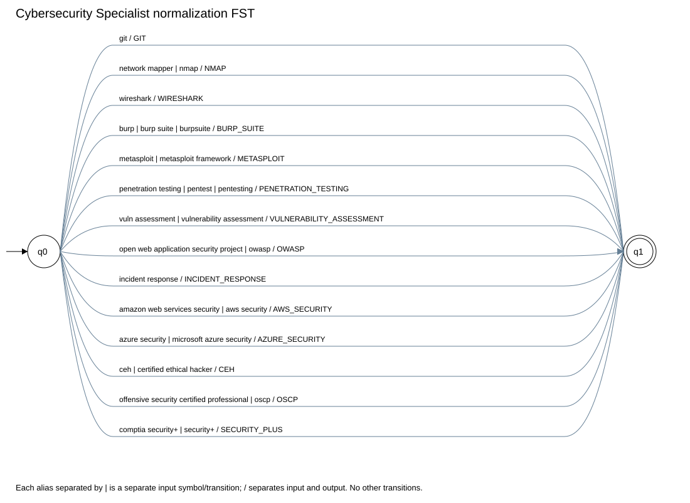
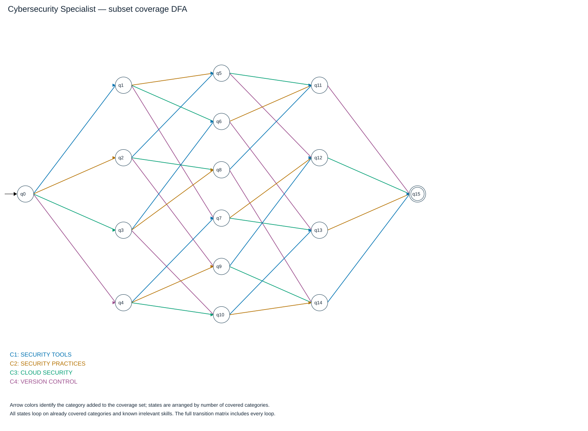

# Cybersecurity Specialist: formal models

The subset construction preserves Emmanuel's published classifier at `4a102a7`.
The adapter preserves its coverage policy and sequential state names, and maps the shared technology alphabet to the published symbols.

## Stage 1 skill expressions

| Term | Recognized aliases |
|---|---|
| GIT | Git |
| NMAP | Nmap, Network Mapper |
| WIRESHARK | Wireshark |
| BURP_SUITE | Burp Suite, BurpSuite, Burp |
| METASPLOIT | Metasploit, Metasploit Framework |
| PENETRATION_TESTING | Penetration Testing, Pentesting, Pentest |
| VULNERABILITY_ASSESSMENT | Vulnerability Assessment, Vuln Assessment |
| OWASP | OWASP, Open Web Application Security Project |
| INCIDENT_RESPONSE | Incident Response |
| AWS_SECURITY | AWS Security, Amazon Web Services Security |
| AZURE_SECURITY | Azure Security, Microsoft Azure Security |
| CEH | CEH, Certified Ethical Hacker |
| OSCP | OSCP, Offensive Security Certified Professional |
| SECURITY_PLUS | Security+, CompTIA Security+ |

Regex construction and shared FST definitions: [shared models](shared_models.md).

## Stage 2 profile vocabulary projection

All profiles use the same skill FST. PostgreSQL and MySQL remain distinct in the DSL; the classifier treats them as database evidence.
The profile-specific alias table below is also implemented as a pyformlang FST for direct compatibility calls.

M = (Q, Sigma, Gamma, delta, omega, q0, F).

- Q = {q0, q1}; initial state q0; accepting states F = {q1}.
- Sigma is exactly the set of complete input aliases in the table below.
- Gamma = {AWS_SECURITY, AZURE_SECURITY, BURP_SUITE, CEH, GIT, INCIDENT_RESPONSE, METASPLOIT, NMAP, OSCP, OWASP, PENETRATION_TESTING, SECURITY_PLUS, VULNERABILITY_ASSESSMENT, WIRESHARK}.
- For each row (x, y), delta(q0, x) = q1 and omega(q0, x) = y.
- The API represents the one-symbol output y as [y]. All other transitions are absent.
- Each alias is translated independently from q0; the caller does not concatenate all aliases into one character string.

| Input token x | Output token y | delta | omega |
|---|---|---|---|
| `git` | `GIT` | q0 to q1 | [GIT] |
| `network mapper` | `NMAP` | q0 to q1 | [NMAP] |
| `nmap` | `NMAP` | q0 to q1 | [NMAP] |
| `wireshark` | `WIRESHARK` | q0 to q1 | [WIRESHARK] |
| `burp` | `BURP_SUITE` | q0 to q1 | [BURP_SUITE] |
| `burp suite` | `BURP_SUITE` | q0 to q1 | [BURP_SUITE] |
| `burpsuite` | `BURP_SUITE` | q0 to q1 | [BURP_SUITE] |
| `metasploit` | `METASPLOIT` | q0 to q1 | [METASPLOIT] |
| `metasploit framework` | `METASPLOIT` | q0 to q1 | [METASPLOIT] |
| `penetration testing` | `PENETRATION_TESTING` | q0 to q1 | [PENETRATION_TESTING] |
| `pentest` | `PENETRATION_TESTING` | q0 to q1 | [PENETRATION_TESTING] |
| `pentesting` | `PENETRATION_TESTING` | q0 to q1 | [PENETRATION_TESTING] |
| `vuln assessment` | `VULNERABILITY_ASSESSMENT` | q0 to q1 | [VULNERABILITY_ASSESSMENT] |
| `vulnerability assessment` | `VULNERABILITY_ASSESSMENT` | q0 to q1 | [VULNERABILITY_ASSESSMENT] |
| `open web application security project` | `OWASP` | q0 to q1 | [OWASP] |
| `owasp` | `OWASP` | q0 to q1 | [OWASP] |
| `incident response` | `INCIDENT_RESPONSE` | q0 to q1 | [INCIDENT_RESPONSE] |
| `amazon web services security` | `AWS_SECURITY` | q0 to q1 | [AWS_SECURITY] |
| `aws security` | `AWS_SECURITY` | q0 to q1 | [AWS_SECURITY] |
| `azure security` | `AZURE_SECURITY` | q0 to q1 | [AZURE_SECURITY] |
| `microsoft azure security` | `AZURE_SECURITY` | q0 to q1 | [AZURE_SECURITY] |
| `ceh` | `CEH` | q0 to q1 | [CEH] |
| `certified ethical hacker` | `CEH` | q0 to q1 | [CEH] |
| `offensive security certified professional` | `OSCP` | q0 to q1 | [OSCP] |
| `oscp` | `OSCP` | q0 to q1 | [OSCP] |
| `comptia security+` | `SECURITY_PLUS` | q0 to q1 | [SECURITY_PLUS] |
| `security+` | `SECURITY_PLUS` | q0 to q1 | [SECURITY_PLUS] |

## Stage 3 DFA: complete 5-tuple

M = (Q, Sigma, delta, q0, F).

- Q = {q0, q1, q2, q3, q4, q5, q6, q7, q8, q9, q10, q11, q12, q13, q14, q15}.
- Sigma = {AIRFLOW, ANGULAR, AWS, AWS_SECURITY, AZURE, AZURE_SECURITY, BIGQUERY, BURP_SUITE, CEH, DATA_MODELING, DIMENSIONAL_MODELING, DJANGO, GCP, GIT, INCIDENT_RESPONSE, JAVASCRIPT, KAFKA, METASPLOIT, MONGODB, MYSQL, NMAP, NODEJS, NOSQL, NUMPY, OSCP, OWASP, PANDAS, PENETRATION_TESTING, POSTGRESQL, PYTHON, PYTORCH, REACT, REDSHIFT, REST_API, SCIKIT_LEARN, SECURITY_PLUS, SNOWFLAKE, SPARK, SPRING_BOOT, SQL, TENSORFLOW, TYPESCRIPT, VUE, VULNERABILITY_ASSESSMENT, WIRESHARK}.
- q0 = q0 (empty coverage).
- F = {q15} (all required categories covered).
- State qN follows the contributor's sequential enumeration by coverage size. The coverage table below specifies its meaning.
- delta adds the category evidenced by a skill, or keeps the state for an already covered category or a known irrelevant skill.
- The complete transition function is the executable-model matrix below. Unknown symbols outside Sigma have no transition and are rejected.
- One target per state/symbol pair and no epsilon transitions make this a DFA.
- AND across required categories; OR among alternatives. The order and duplicates do not affect coverage.
- CEH, OSCP and Security+ are optional skills, not requirements.

| Category index | Area |
|---|---|
| 0 | SECURITY TOOLS |
| 1 | SECURITY PRACTICES |
| 2 | CLOUD SECURITY |
| 3 | VERSION CONTROL |

| State | Covered categories |
|---|---|
| q0 | (none) |
| q1 | SECURITY TOOLS |
| q2 | SECURITY PRACTICES |
| q3 | CLOUD SECURITY |
| q4 | VERSION CONTROL |
| q5 | SECURITY TOOLS, SECURITY PRACTICES |
| q6 | SECURITY TOOLS, CLOUD SECURITY |
| q7 | SECURITY TOOLS, VERSION CONTROL |
| q8 | SECURITY PRACTICES, CLOUD SECURITY |
| q9 | SECURITY PRACTICES, VERSION CONTROL |
| q10 | CLOUD SECURITY, VERSION CONTROL |
| q11 | SECURITY TOOLS, SECURITY PRACTICES, CLOUD SECURITY |
| q12 | SECURITY TOOLS, SECURITY PRACTICES, VERSION CONTROL |
| q13 | SECURITY TOOLS, CLOUD SECURITY, VERSION CONTROL |
| q14 | SECURITY PRACTICES, CLOUD SECURITY, VERSION CONTROL |
| q15 | SECURITY TOOLS, SECURITY PRACTICES, CLOUD SECURITY, VERSION CONTROL |

| Required category | Alternative evidence |
|---|---|
| Security tools | NMAP or WIRESHARK or BURP_SUITE or METASPLOIT |
| Security practices | PENETRATION_TESTING or VULNERABILITY_ASSESSMENT or OWASP or INCIDENT_RESPONSE |
| Cloud security | AWS_SECURITY or AZURE_SECURITY |
| Version control | GIT |

[All DFA transitions](diagrams/cybersecurity_dfa.dot)

## Full transition matrix

| State | AIRFLOW | ANGULAR | AWS | AWS_SECURITY | AZURE | AZURE_SECURITY | BIGQUERY | BURP_SUITE | CEH | DATA_MODELING | DIMENSIONAL_MODELING | DJANGO | GCP | GIT | INCIDENT_RESPONSE | JAVASCRIPT | KAFKA | METASPLOIT | MONGODB | MYSQL | NMAP | NODEJS | NOSQL | NUMPY | OSCP | OWASP | PANDAS | PENETRATION_TESTING | POSTGRESQL | PYTHON | PYTORCH | REACT | REDSHIFT | REST_API | SCIKIT_LEARN | SECURITY_PLUS | SNOWFLAKE | SPARK | SPRING_BOOT | SQL | TENSORFLOW | TYPESCRIPT | VUE | VULNERABILITY_ASSESSMENT | WIRESHARK |
|---|---|---|---|---|---|---|---|---|---|---|---|---|---|---|---|---|---|---|---|---|---|---|---|---|---|---|---|---|---|---|---|---|---|---|---|---|---|---|---|---|---|---|---|---|---|
| -> q0 | q0 | q0 | q0 | q3 | q0 | q3 | q0 | q1 | q0 | q0 | q0 | q0 | q0 | q4 | q2 | q0 | q0 | q1 | q0 | q0 | q1 | q0 | q0 | q0 | q0 | q2 | q0 | q2 | q0 | q0 | q0 | q0 | q0 | q0 | q0 | q0 | q0 | q0 | q0 | q0 | q0 | q0 | q0 | q2 | q1 |
| q1 | q1 | q1 | q1 | q6 | q1 | q6 | q1 | q1 | q1 | q1 | q1 | q1 | q1 | q7 | q5 | q1 | q1 | q1 | q1 | q1 | q1 | q1 | q1 | q1 | q1 | q5 | q1 | q5 | q1 | q1 | q1 | q1 | q1 | q1 | q1 | q1 | q1 | q1 | q1 | q1 | q1 | q1 | q1 | q5 | q1 |
| q2 | q2 | q2 | q2 | q8 | q2 | q8 | q2 | q5 | q2 | q2 | q2 | q2 | q2 | q9 | q2 | q2 | q2 | q5 | q2 | q2 | q5 | q2 | q2 | q2 | q2 | q2 | q2 | q2 | q2 | q2 | q2 | q2 | q2 | q2 | q2 | q2 | q2 | q2 | q2 | q2 | q2 | q2 | q2 | q2 | q5 |
| q3 | q3 | q3 | q3 | q3 | q3 | q3 | q3 | q6 | q3 | q3 | q3 | q3 | q3 | q10 | q8 | q3 | q3 | q6 | q3 | q3 | q6 | q3 | q3 | q3 | q3 | q8 | q3 | q8 | q3 | q3 | q3 | q3 | q3 | q3 | q3 | q3 | q3 | q3 | q3 | q3 | q3 | q3 | q3 | q8 | q6 |
| q4 | q4 | q4 | q4 | q10 | q4 | q10 | q4 | q7 | q4 | q4 | q4 | q4 | q4 | q4 | q9 | q4 | q4 | q7 | q4 | q4 | q7 | q4 | q4 | q4 | q4 | q9 | q4 | q9 | q4 | q4 | q4 | q4 | q4 | q4 | q4 | q4 | q4 | q4 | q4 | q4 | q4 | q4 | q4 | q9 | q7 |
| q5 | q5 | q5 | q5 | q11 | q5 | q11 | q5 | q5 | q5 | q5 | q5 | q5 | q5 | q12 | q5 | q5 | q5 | q5 | q5 | q5 | q5 | q5 | q5 | q5 | q5 | q5 | q5 | q5 | q5 | q5 | q5 | q5 | q5 | q5 | q5 | q5 | q5 | q5 | q5 | q5 | q5 | q5 | q5 | q5 | q5 |
| q6 | q6 | q6 | q6 | q6 | q6 | q6 | q6 | q6 | q6 | q6 | q6 | q6 | q6 | q13 | q11 | q6 | q6 | q6 | q6 | q6 | q6 | q6 | q6 | q6 | q6 | q11 | q6 | q11 | q6 | q6 | q6 | q6 | q6 | q6 | q6 | q6 | q6 | q6 | q6 | q6 | q6 | q6 | q6 | q11 | q6 |
| q7 | q7 | q7 | q7 | q13 | q7 | q13 | q7 | q7 | q7 | q7 | q7 | q7 | q7 | q7 | q12 | q7 | q7 | q7 | q7 | q7 | q7 | q7 | q7 | q7 | q7 | q12 | q7 | q12 | q7 | q7 | q7 | q7 | q7 | q7 | q7 | q7 | q7 | q7 | q7 | q7 | q7 | q7 | q7 | q12 | q7 |
| q8 | q8 | q8 | q8 | q8 | q8 | q8 | q8 | q11 | q8 | q8 | q8 | q8 | q8 | q14 | q8 | q8 | q8 | q11 | q8 | q8 | q11 | q8 | q8 | q8 | q8 | q8 | q8 | q8 | q8 | q8 | q8 | q8 | q8 | q8 | q8 | q8 | q8 | q8 | q8 | q8 | q8 | q8 | q8 | q8 | q11 |
| q9 | q9 | q9 | q9 | q14 | q9 | q14 | q9 | q12 | q9 | q9 | q9 | q9 | q9 | q9 | q9 | q9 | q9 | q12 | q9 | q9 | q12 | q9 | q9 | q9 | q9 | q9 | q9 | q9 | q9 | q9 | q9 | q9 | q9 | q9 | q9 | q9 | q9 | q9 | q9 | q9 | q9 | q9 | q9 | q9 | q12 |
| q10 | q10 | q10 | q10 | q10 | q10 | q10 | q10 | q13 | q10 | q10 | q10 | q10 | q10 | q10 | q14 | q10 | q10 | q13 | q10 | q10 | q13 | q10 | q10 | q10 | q10 | q14 | q10 | q14 | q10 | q10 | q10 | q10 | q10 | q10 | q10 | q10 | q10 | q10 | q10 | q10 | q10 | q10 | q10 | q14 | q13 |
| q11 | q11 | q11 | q11 | q11 | q11 | q11 | q11 | q11 | q11 | q11 | q11 | q11 | q11 | q15 | q11 | q11 | q11 | q11 | q11 | q11 | q11 | q11 | q11 | q11 | q11 | q11 | q11 | q11 | q11 | q11 | q11 | q11 | q11 | q11 | q11 | q11 | q11 | q11 | q11 | q11 | q11 | q11 | q11 | q11 | q11 |
| q12 | q12 | q12 | q12 | q15 | q12 | q15 | q12 | q12 | q12 | q12 | q12 | q12 | q12 | q12 | q12 | q12 | q12 | q12 | q12 | q12 | q12 | q12 | q12 | q12 | q12 | q12 | q12 | q12 | q12 | q12 | q12 | q12 | q12 | q12 | q12 | q12 | q12 | q12 | q12 | q12 | q12 | q12 | q12 | q12 | q12 |
| q13 | q13 | q13 | q13 | q13 | q13 | q13 | q13 | q13 | q13 | q13 | q13 | q13 | q13 | q13 | q15 | q13 | q13 | q13 | q13 | q13 | q13 | q13 | q13 | q13 | q13 | q15 | q13 | q15 | q13 | q13 | q13 | q13 | q13 | q13 | q13 | q13 | q13 | q13 | q13 | q13 | q13 | q13 | q13 | q15 | q13 |
| q14 | q14 | q14 | q14 | q14 | q14 | q14 | q14 | q15 | q14 | q14 | q14 | q14 | q14 | q14 | q14 | q14 | q14 | q15 | q14 | q14 | q15 | q14 | q14 | q14 | q14 | q14 | q14 | q14 | q14 | q14 | q14 | q14 | q14 | q14 | q14 | q14 | q14 | q14 | q14 | q14 | q14 | q14 | q14 | q14 | q15 |
| * q15 | q15 | q15 | q15 | q15 | q15 | q15 | q15 | q15 | q15 | q15 | q15 | q15 | q15 | q15 | q15 | q15 | q15 | q15 | q15 | q15 | q15 | q15 | q15 | q15 | q15 | q15 | q15 | q15 | q15 | q15 | q15 | q15 | q15 | q15 | q15 | q15 | q15 | q15 | q15 | q15 | q15 | q15 | q15 | q15 | q15 |
