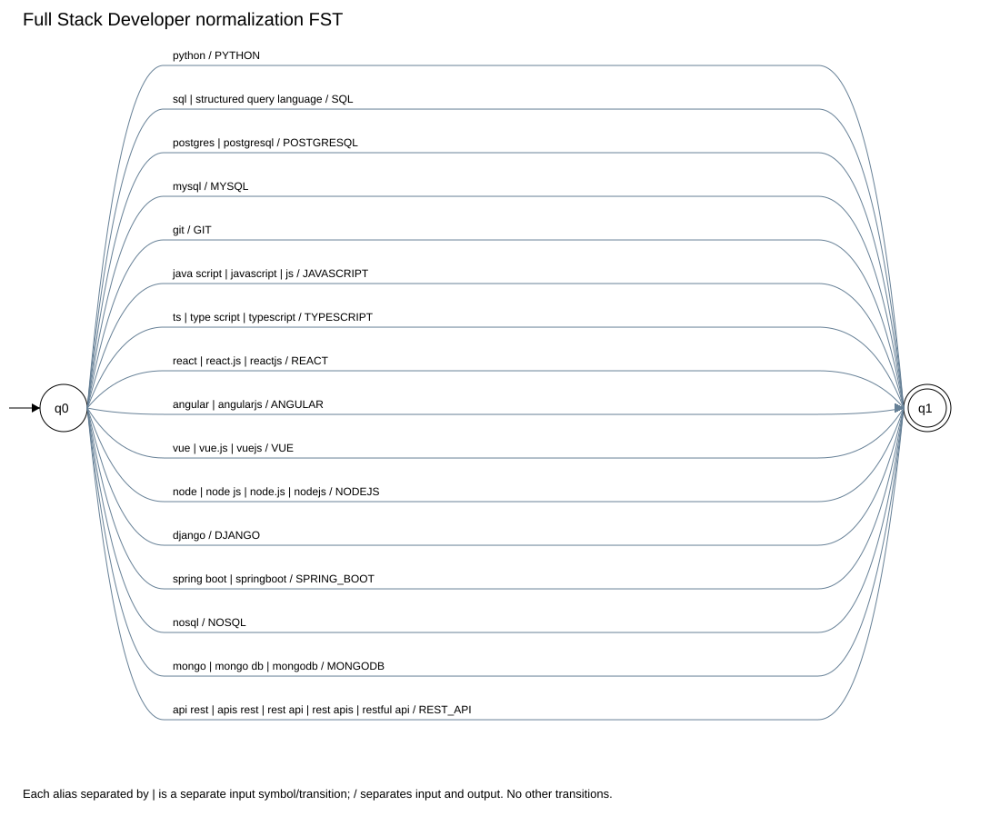
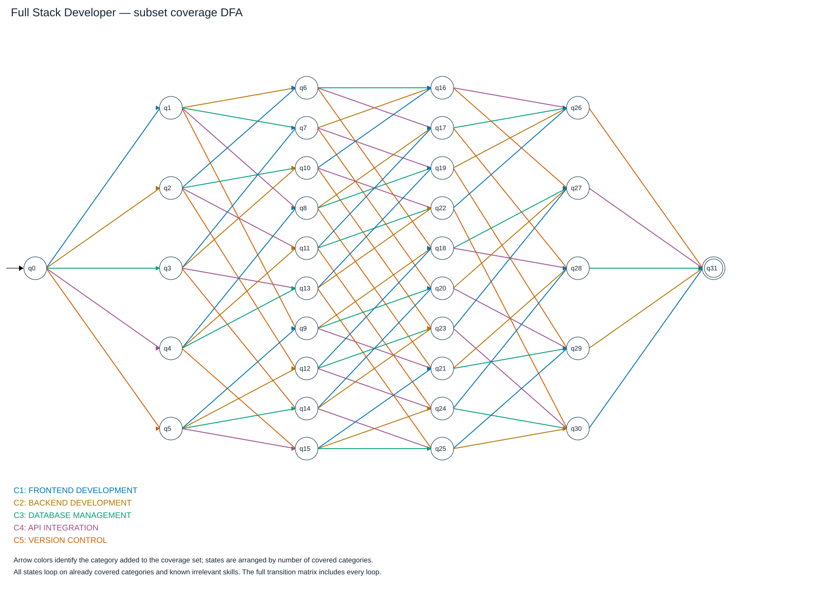

# Full Stack Developer: formal models

The subset construction preserves Emmanuel's published classifier at `4a102a7`.
The adapter preserves its coverage policy and sequential state names, and maps the shared technology alphabet to the published symbols.

## Stage 1 skill expressions

| Term | Recognized aliases |
|---|---|
| PYTHON | Python |
| SQL | SQL, Structured Query Language |
| POSTGRESQL | PostgreSQL, Postgres |
| MYSQL | MySQL |
| GIT | Git |
| JAVASCRIPT | JavaScript, Java Script, JS |
| TYPESCRIPT | TypeScript, Type Script, TS |
| REACT | React.js, ReactJS, React |
| ANGULAR | Angular, AngularJS |
| VUE | Vue.js, VueJS, Vue |
| NODEJS | Node.js, NodeJS, Node JS, Node |
| DJANGO | Django |
| SPRING_BOOT | Spring Boot, SpringBoot |
| NOSQL | NoSQL |
| MONGODB | MongoDB, Mongo DB, Mongo |
| REST_API | RESTful API, REST API, APIs REST, API REST, REST APIs |

Regex construction and shared FST definitions: [shared models](shared_models.md).

## Stage 2 profile vocabulary projection

All profiles use the same skill FST. PostgreSQL and MySQL remain distinct in the DSL; the classifier treats them as database evidence.
The profile-specific alias table below is also implemented as a pyformlang FST for direct compatibility calls.

M = (Q, Sigma, Gamma, delta, omega, q0, F).

- Q = {q0, q1}; initial state q0; accepting states F = {q1}.
- Sigma is exactly the set of complete input aliases in the table below.
- Gamma = {ANGULAR, DJANGO, GIT, JAVASCRIPT, MONGODB, MYSQL, NODEJS, NOSQL, POSTGRESQL, PYTHON, REACT, REST_API, SPRING_BOOT, SQL, TYPESCRIPT, VUE}.
- For each row (x, y), delta(q0, x) = q1 and omega(q0, x) = y.
- The API represents the one-symbol output y as [y]. All other transitions are absent.
- Each alias is translated independently from q0; the caller does not concatenate all aliases into one character string.

| Input token x | Output token y | delta | omega |
|---|---|---|---|
| `python` | `PYTHON` | q0 to q1 | [PYTHON] |
| `sql` | `SQL` | q0 to q1 | [SQL] |
| `structured query language` | `SQL` | q0 to q1 | [SQL] |
| `postgres` | `POSTGRESQL` | q0 to q1 | [POSTGRESQL] |
| `postgresql` | `POSTGRESQL` | q0 to q1 | [POSTGRESQL] |
| `mysql` | `MYSQL` | q0 to q1 | [MYSQL] |
| `git` | `GIT` | q0 to q1 | [GIT] |
| `java script` | `JAVASCRIPT` | q0 to q1 | [JAVASCRIPT] |
| `javascript` | `JAVASCRIPT` | q0 to q1 | [JAVASCRIPT] |
| `js` | `JAVASCRIPT` | q0 to q1 | [JAVASCRIPT] |
| `ts` | `TYPESCRIPT` | q0 to q1 | [TYPESCRIPT] |
| `type script` | `TYPESCRIPT` | q0 to q1 | [TYPESCRIPT] |
| `typescript` | `TYPESCRIPT` | q0 to q1 | [TYPESCRIPT] |
| `react` | `REACT` | q0 to q1 | [REACT] |
| `react.js` | `REACT` | q0 to q1 | [REACT] |
| `reactjs` | `REACT` | q0 to q1 | [REACT] |
| `angular` | `ANGULAR` | q0 to q1 | [ANGULAR] |
| `angularjs` | `ANGULAR` | q0 to q1 | [ANGULAR] |
| `vue` | `VUE` | q0 to q1 | [VUE] |
| `vue.js` | `VUE` | q0 to q1 | [VUE] |
| `vuejs` | `VUE` | q0 to q1 | [VUE] |
| `node` | `NODEJS` | q0 to q1 | [NODEJS] |
| `node js` | `NODEJS` | q0 to q1 | [NODEJS] |
| `node.js` | `NODEJS` | q0 to q1 | [NODEJS] |
| `nodejs` | `NODEJS` | q0 to q1 | [NODEJS] |
| `django` | `DJANGO` | q0 to q1 | [DJANGO] |
| `spring boot` | `SPRING_BOOT` | q0 to q1 | [SPRING_BOOT] |
| `springboot` | `SPRING_BOOT` | q0 to q1 | [SPRING_BOOT] |
| `nosql` | `NOSQL` | q0 to q1 | [NOSQL] |
| `mongo` | `MONGODB` | q0 to q1 | [MONGODB] |
| `mongo db` | `MONGODB` | q0 to q1 | [MONGODB] |
| `mongodb` | `MONGODB` | q0 to q1 | [MONGODB] |
| `api rest` | `REST_API` | q0 to q1 | [REST_API] |
| `apis rest` | `REST_API` | q0 to q1 | [REST_API] |
| `rest api` | `REST_API` | q0 to q1 | [REST_API] |
| `rest apis` | `REST_API` | q0 to q1 | [REST_API] |
| `restful api` | `REST_API` | q0 to q1 | [REST_API] |

## Stage 3 DFA: complete 5-tuple

M = (Q, Sigma, delta, q0, F).

- Q = {q0, q1, q2, q3, q4, q5, q6, q7, q8, q9, q10, q11, q12, q13, q14, q15, q16, q17, q18, q19, q20, q21, q22, q23, q24, q25, q26, q27, q28, q29, q30, q31}.
- Sigma = {AIRFLOW, ANGULAR, AWS, AWS_SECURITY, AZURE, AZURE_SECURITY, BIGQUERY, BURP_SUITE, CEH, DATA_MODELING, DIMENSIONAL_MODELING, DJANGO, GCP, GIT, INCIDENT_RESPONSE, JAVASCRIPT, KAFKA, METASPLOIT, MONGODB, MYSQL, NMAP, NODEJS, NOSQL, NUMPY, OSCP, OWASP, PANDAS, PENETRATION_TESTING, POSTGRESQL, PYTHON, PYTORCH, REACT, REDSHIFT, REST_API, SCIKIT_LEARN, SECURITY_PLUS, SNOWFLAKE, SPARK, SPRING_BOOT, SQL, TENSORFLOW, TYPESCRIPT, VUE, VULNERABILITY_ASSESSMENT, WIRESHARK}.
- q0 = q0 (empty coverage).
- F = {q31} (all required categories covered).
- State qN follows the contributor's sequential enumeration by coverage size. The coverage table below specifies its meaning.
- delta adds the category evidenced by a skill, or keeps the state for an already covered category or a known irrelevant skill.
- The complete transition function is the executable-model matrix below. Unknown symbols outside Sigma have no transition and are rejected.
- One target per state/symbol pair and no epsilon transitions make this a DFA.
- AND across required categories; OR among alternatives. The order and duplicates do not affect coverage.
- CEH, OSCP and Security+ are optional skills, not requirements.

| Category index | Area |
|---|---|
| 0 | FRONTEND DEVELOPMENT |
| 1 | BACKEND DEVELOPMENT |
| 2 | DATABASE MANAGEMENT |
| 3 | API INTEGRATION |
| 4 | VERSION CONTROL |

| State | Covered categories |
|---|---|
| q0 | (none) |
| q1 | FRONTEND DEVELOPMENT |
| q2 | BACKEND DEVELOPMENT |
| q3 | DATABASE MANAGEMENT |
| q4 | API INTEGRATION |
| q5 | VERSION CONTROL |
| q6 | FRONTEND DEVELOPMENT, BACKEND DEVELOPMENT |
| q7 | FRONTEND DEVELOPMENT, DATABASE MANAGEMENT |
| q8 | FRONTEND DEVELOPMENT, API INTEGRATION |
| q9 | FRONTEND DEVELOPMENT, VERSION CONTROL |
| q10 | BACKEND DEVELOPMENT, DATABASE MANAGEMENT |
| q11 | BACKEND DEVELOPMENT, API INTEGRATION |
| q12 | BACKEND DEVELOPMENT, VERSION CONTROL |
| q13 | DATABASE MANAGEMENT, API INTEGRATION |
| q14 | DATABASE MANAGEMENT, VERSION CONTROL |
| q15 | API INTEGRATION, VERSION CONTROL |
| q16 | FRONTEND DEVELOPMENT, BACKEND DEVELOPMENT, DATABASE MANAGEMENT |
| q17 | FRONTEND DEVELOPMENT, BACKEND DEVELOPMENT, API INTEGRATION |
| q18 | FRONTEND DEVELOPMENT, BACKEND DEVELOPMENT, VERSION CONTROL |
| q19 | FRONTEND DEVELOPMENT, DATABASE MANAGEMENT, API INTEGRATION |
| q20 | FRONTEND DEVELOPMENT, DATABASE MANAGEMENT, VERSION CONTROL |
| q21 | FRONTEND DEVELOPMENT, API INTEGRATION, VERSION CONTROL |
| q22 | BACKEND DEVELOPMENT, DATABASE MANAGEMENT, API INTEGRATION |
| q23 | BACKEND DEVELOPMENT, DATABASE MANAGEMENT, VERSION CONTROL |
| q24 | BACKEND DEVELOPMENT, API INTEGRATION, VERSION CONTROL |
| q25 | DATABASE MANAGEMENT, API INTEGRATION, VERSION CONTROL |
| q26 | FRONTEND DEVELOPMENT, BACKEND DEVELOPMENT, DATABASE MANAGEMENT, API INTEGRATION |
| q27 | FRONTEND DEVELOPMENT, BACKEND DEVELOPMENT, DATABASE MANAGEMENT, VERSION CONTROL |
| q28 | FRONTEND DEVELOPMENT, BACKEND DEVELOPMENT, API INTEGRATION, VERSION CONTROL |
| q29 | FRONTEND DEVELOPMENT, DATABASE MANAGEMENT, API INTEGRATION, VERSION CONTROL |
| q30 | BACKEND DEVELOPMENT, DATABASE MANAGEMENT, API INTEGRATION, VERSION CONTROL |
| q31 | FRONTEND DEVELOPMENT, BACKEND DEVELOPMENT, DATABASE MANAGEMENT, API INTEGRATION, VERSION CONTROL |

| Required category | Alternative evidence |
|---|---|
| Frontend development | JAVASCRIPT or TYPESCRIPT or REACT or ANGULAR or VUE |
| Backend development | NODEJS or DJANGO or SPRING_BOOT |
| Database management | SQL or POSTGRESQL or MYSQL or NOSQL or MONGODB |
| API integration | REST_API |
| Version control | GIT |

[All DFA transitions](diagrams/full_stack_dfa.dot)

## Full transition matrix

| State | AIRFLOW | ANGULAR | AWS | AWS_SECURITY | AZURE | AZURE_SECURITY | BIGQUERY | BURP_SUITE | CEH | DATA_MODELING | DIMENSIONAL_MODELING | DJANGO | GCP | GIT | INCIDENT_RESPONSE | JAVASCRIPT | KAFKA | METASPLOIT | MONGODB | MYSQL | NMAP | NODEJS | NOSQL | NUMPY | OSCP | OWASP | PANDAS | PENETRATION_TESTING | POSTGRESQL | PYTHON | PYTORCH | REACT | REDSHIFT | REST_API | SCIKIT_LEARN | SECURITY_PLUS | SNOWFLAKE | SPARK | SPRING_BOOT | SQL | TENSORFLOW | TYPESCRIPT | VUE | VULNERABILITY_ASSESSMENT | WIRESHARK |
|---|---|---|---|---|---|---|---|---|---|---|---|---|---|---|---|---|---|---|---|---|---|---|---|---|---|---|---|---|---|---|---|---|---|---|---|---|---|---|---|---|---|---|---|---|---|
| -> q0 | q0 | q1 | q0 | q0 | q0 | q0 | q0 | q0 | q0 | q0 | q0 | q2 | q0 | q5 | q0 | q1 | q0 | q0 | q3 | q3 | q0 | q2 | q3 | q0 | q0 | q0 | q0 | q0 | q3 | q0 | q0 | q1 | q0 | q4 | q0 | q0 | q0 | q0 | q2 | q3 | q0 | q1 | q1 | q0 | q0 |
| q1 | q1 | q1 | q1 | q1 | q1 | q1 | q1 | q1 | q1 | q1 | q1 | q6 | q1 | q9 | q1 | q1 | q1 | q1 | q7 | q7 | q1 | q6 | q7 | q1 | q1 | q1 | q1 | q1 | q7 | q1 | q1 | q1 | q1 | q8 | q1 | q1 | q1 | q1 | q6 | q7 | q1 | q1 | q1 | q1 | q1 |
| q2 | q2 | q6 | q2 | q2 | q2 | q2 | q2 | q2 | q2 | q2 | q2 | q2 | q2 | q12 | q2 | q6 | q2 | q2 | q10 | q10 | q2 | q2 | q10 | q2 | q2 | q2 | q2 | q2 | q10 | q2 | q2 | q6 | q2 | q11 | q2 | q2 | q2 | q2 | q2 | q10 | q2 | q6 | q6 | q2 | q2 |
| q3 | q3 | q7 | q3 | q3 | q3 | q3 | q3 | q3 | q3 | q3 | q3 | q10 | q3 | q14 | q3 | q7 | q3 | q3 | q3 | q3 | q3 | q10 | q3 | q3 | q3 | q3 | q3 | q3 | q3 | q3 | q3 | q7 | q3 | q13 | q3 | q3 | q3 | q3 | q10 | q3 | q3 | q7 | q7 | q3 | q3 |
| q4 | q4 | q8 | q4 | q4 | q4 | q4 | q4 | q4 | q4 | q4 | q4 | q11 | q4 | q15 | q4 | q8 | q4 | q4 | q13 | q13 | q4 | q11 | q13 | q4 | q4 | q4 | q4 | q4 | q13 | q4 | q4 | q8 | q4 | q4 | q4 | q4 | q4 | q4 | q11 | q13 | q4 | q8 | q8 | q4 | q4 |
| q5 | q5 | q9 | q5 | q5 | q5 | q5 | q5 | q5 | q5 | q5 | q5 | q12 | q5 | q5 | q5 | q9 | q5 | q5 | q14 | q14 | q5 | q12 | q14 | q5 | q5 | q5 | q5 | q5 | q14 | q5 | q5 | q9 | q5 | q15 | q5 | q5 | q5 | q5 | q12 | q14 | q5 | q9 | q9 | q5 | q5 |
| q6 | q6 | q6 | q6 | q6 | q6 | q6 | q6 | q6 | q6 | q6 | q6 | q6 | q6 | q18 | q6 | q6 | q6 | q6 | q16 | q16 | q6 | q6 | q16 | q6 | q6 | q6 | q6 | q6 | q16 | q6 | q6 | q6 | q6 | q17 | q6 | q6 | q6 | q6 | q6 | q16 | q6 | q6 | q6 | q6 | q6 |
| q7 | q7 | q7 | q7 | q7 | q7 | q7 | q7 | q7 | q7 | q7 | q7 | q16 | q7 | q20 | q7 | q7 | q7 | q7 | q7 | q7 | q7 | q16 | q7 | q7 | q7 | q7 | q7 | q7 | q7 | q7 | q7 | q7 | q7 | q19 | q7 | q7 | q7 | q7 | q16 | q7 | q7 | q7 | q7 | q7 | q7 |
| q8 | q8 | q8 | q8 | q8 | q8 | q8 | q8 | q8 | q8 | q8 | q8 | q17 | q8 | q21 | q8 | q8 | q8 | q8 | q19 | q19 | q8 | q17 | q19 | q8 | q8 | q8 | q8 | q8 | q19 | q8 | q8 | q8 | q8 | q8 | q8 | q8 | q8 | q8 | q17 | q19 | q8 | q8 | q8 | q8 | q8 |
| q9 | q9 | q9 | q9 | q9 | q9 | q9 | q9 | q9 | q9 | q9 | q9 | q18 | q9 | q9 | q9 | q9 | q9 | q9 | q20 | q20 | q9 | q18 | q20 | q9 | q9 | q9 | q9 | q9 | q20 | q9 | q9 | q9 | q9 | q21 | q9 | q9 | q9 | q9 | q18 | q20 | q9 | q9 | q9 | q9 | q9 |
| q10 | q10 | q16 | q10 | q10 | q10 | q10 | q10 | q10 | q10 | q10 | q10 | q10 | q10 | q23 | q10 | q16 | q10 | q10 | q10 | q10 | q10 | q10 | q10 | q10 | q10 | q10 | q10 | q10 | q10 | q10 | q10 | q16 | q10 | q22 | q10 | q10 | q10 | q10 | q10 | q10 | q10 | q16 | q16 | q10 | q10 |
| q11 | q11 | q17 | q11 | q11 | q11 | q11 | q11 | q11 | q11 | q11 | q11 | q11 | q11 | q24 | q11 | q17 | q11 | q11 | q22 | q22 | q11 | q11 | q22 | q11 | q11 | q11 | q11 | q11 | q22 | q11 | q11 | q17 | q11 | q11 | q11 | q11 | q11 | q11 | q11 | q22 | q11 | q17 | q17 | q11 | q11 |
| q12 | q12 | q18 | q12 | q12 | q12 | q12 | q12 | q12 | q12 | q12 | q12 | q12 | q12 | q12 | q12 | q18 | q12 | q12 | q23 | q23 | q12 | q12 | q23 | q12 | q12 | q12 | q12 | q12 | q23 | q12 | q12 | q18 | q12 | q24 | q12 | q12 | q12 | q12 | q12 | q23 | q12 | q18 | q18 | q12 | q12 |
| q13 | q13 | q19 | q13 | q13 | q13 | q13 | q13 | q13 | q13 | q13 | q13 | q22 | q13 | q25 | q13 | q19 | q13 | q13 | q13 | q13 | q13 | q22 | q13 | q13 | q13 | q13 | q13 | q13 | q13 | q13 | q13 | q19 | q13 | q13 | q13 | q13 | q13 | q13 | q22 | q13 | q13 | q19 | q19 | q13 | q13 |
| q14 | q14 | q20 | q14 | q14 | q14 | q14 | q14 | q14 | q14 | q14 | q14 | q23 | q14 | q14 | q14 | q20 | q14 | q14 | q14 | q14 | q14 | q23 | q14 | q14 | q14 | q14 | q14 | q14 | q14 | q14 | q14 | q20 | q14 | q25 | q14 | q14 | q14 | q14 | q23 | q14 | q14 | q20 | q20 | q14 | q14 |
| q15 | q15 | q21 | q15 | q15 | q15 | q15 | q15 | q15 | q15 | q15 | q15 | q24 | q15 | q15 | q15 | q21 | q15 | q15 | q25 | q25 | q15 | q24 | q25 | q15 | q15 | q15 | q15 | q15 | q25 | q15 | q15 | q21 | q15 | q15 | q15 | q15 | q15 | q15 | q24 | q25 | q15 | q21 | q21 | q15 | q15 |
| q16 | q16 | q16 | q16 | q16 | q16 | q16 | q16 | q16 | q16 | q16 | q16 | q16 | q16 | q27 | q16 | q16 | q16 | q16 | q16 | q16 | q16 | q16 | q16 | q16 | q16 | q16 | q16 | q16 | q16 | q16 | q16 | q16 | q16 | q26 | q16 | q16 | q16 | q16 | q16 | q16 | q16 | q16 | q16 | q16 | q16 |
| q17 | q17 | q17 | q17 | q17 | q17 | q17 | q17 | q17 | q17 | q17 | q17 | q17 | q17 | q28 | q17 | q17 | q17 | q17 | q26 | q26 | q17 | q17 | q26 | q17 | q17 | q17 | q17 | q17 | q26 | q17 | q17 | q17 | q17 | q17 | q17 | q17 | q17 | q17 | q17 | q26 | q17 | q17 | q17 | q17 | q17 |
| q18 | q18 | q18 | q18 | q18 | q18 | q18 | q18 | q18 | q18 | q18 | q18 | q18 | q18 | q18 | q18 | q18 | q18 | q18 | q27 | q27 | q18 | q18 | q27 | q18 | q18 | q18 | q18 | q18 | q27 | q18 | q18 | q18 | q18 | q28 | q18 | q18 | q18 | q18 | q18 | q27 | q18 | q18 | q18 | q18 | q18 |
| q19 | q19 | q19 | q19 | q19 | q19 | q19 | q19 | q19 | q19 | q19 | q19 | q26 | q19 | q29 | q19 | q19 | q19 | q19 | q19 | q19 | q19 | q26 | q19 | q19 | q19 | q19 | q19 | q19 | q19 | q19 | q19 | q19 | q19 | q19 | q19 | q19 | q19 | q19 | q26 | q19 | q19 | q19 | q19 | q19 | q19 |
| q20 | q20 | q20 | q20 | q20 | q20 | q20 | q20 | q20 | q20 | q20 | q20 | q27 | q20 | q20 | q20 | q20 | q20 | q20 | q20 | q20 | q20 | q27 | q20 | q20 | q20 | q20 | q20 | q20 | q20 | q20 | q20 | q20 | q20 | q29 | q20 | q20 | q20 | q20 | q27 | q20 | q20 | q20 | q20 | q20 | q20 |
| q21 | q21 | q21 | q21 | q21 | q21 | q21 | q21 | q21 | q21 | q21 | q21 | q28 | q21 | q21 | q21 | q21 | q21 | q21 | q29 | q29 | q21 | q28 | q29 | q21 | q21 | q21 | q21 | q21 | q29 | q21 | q21 | q21 | q21 | q21 | q21 | q21 | q21 | q21 | q28 | q29 | q21 | q21 | q21 | q21 | q21 |
| q22 | q22 | q26 | q22 | q22 | q22 | q22 | q22 | q22 | q22 | q22 | q22 | q22 | q22 | q30 | q22 | q26 | q22 | q22 | q22 | q22 | q22 | q22 | q22 | q22 | q22 | q22 | q22 | q22 | q22 | q22 | q22 | q26 | q22 | q22 | q22 | q22 | q22 | q22 | q22 | q22 | q22 | q26 | q26 | q22 | q22 |
| q23 | q23 | q27 | q23 | q23 | q23 | q23 | q23 | q23 | q23 | q23 | q23 | q23 | q23 | q23 | q23 | q27 | q23 | q23 | q23 | q23 | q23 | q23 | q23 | q23 | q23 | q23 | q23 | q23 | q23 | q23 | q23 | q27 | q23 | q30 | q23 | q23 | q23 | q23 | q23 | q23 | q23 | q27 | q27 | q23 | q23 |
| q24 | q24 | q28 | q24 | q24 | q24 | q24 | q24 | q24 | q24 | q24 | q24 | q24 | q24 | q24 | q24 | q28 | q24 | q24 | q30 | q30 | q24 | q24 | q30 | q24 | q24 | q24 | q24 | q24 | q30 | q24 | q24 | q28 | q24 | q24 | q24 | q24 | q24 | q24 | q24 | q30 | q24 | q28 | q28 | q24 | q24 |
| q25 | q25 | q29 | q25 | q25 | q25 | q25 | q25 | q25 | q25 | q25 | q25 | q30 | q25 | q25 | q25 | q29 | q25 | q25 | q25 | q25 | q25 | q30 | q25 | q25 | q25 | q25 | q25 | q25 | q25 | q25 | q25 | q29 | q25 | q25 | q25 | q25 | q25 | q25 | q30 | q25 | q25 | q29 | q29 | q25 | q25 |
| q26 | q26 | q26 | q26 | q26 | q26 | q26 | q26 | q26 | q26 | q26 | q26 | q26 | q26 | q31 | q26 | q26 | q26 | q26 | q26 | q26 | q26 | q26 | q26 | q26 | q26 | q26 | q26 | q26 | q26 | q26 | q26 | q26 | q26 | q26 | q26 | q26 | q26 | q26 | q26 | q26 | q26 | q26 | q26 | q26 | q26 |
| q27 | q27 | q27 | q27 | q27 | q27 | q27 | q27 | q27 | q27 | q27 | q27 | q27 | q27 | q27 | q27 | q27 | q27 | q27 | q27 | q27 | q27 | q27 | q27 | q27 | q27 | q27 | q27 | q27 | q27 | q27 | q27 | q27 | q27 | q31 | q27 | q27 | q27 | q27 | q27 | q27 | q27 | q27 | q27 | q27 | q27 |
| q28 | q28 | q28 | q28 | q28 | q28 | q28 | q28 | q28 | q28 | q28 | q28 | q28 | q28 | q28 | q28 | q28 | q28 | q28 | q31 | q31 | q28 | q28 | q31 | q28 | q28 | q28 | q28 | q28 | q31 | q28 | q28 | q28 | q28 | q28 | q28 | q28 | q28 | q28 | q28 | q31 | q28 | q28 | q28 | q28 | q28 |
| q29 | q29 | q29 | q29 | q29 | q29 | q29 | q29 | q29 | q29 | q29 | q29 | q31 | q29 | q29 | q29 | q29 | q29 | q29 | q29 | q29 | q29 | q31 | q29 | q29 | q29 | q29 | q29 | q29 | q29 | q29 | q29 | q29 | q29 | q29 | q29 | q29 | q29 | q29 | q31 | q29 | q29 | q29 | q29 | q29 | q29 |
| q30 | q30 | q31 | q30 | q30 | q30 | q30 | q30 | q30 | q30 | q30 | q30 | q30 | q30 | q30 | q30 | q31 | q30 | q30 | q30 | q30 | q30 | q30 | q30 | q30 | q30 | q30 | q30 | q30 | q30 | q30 | q30 | q31 | q30 | q30 | q30 | q30 | q30 | q30 | q30 | q30 | q30 | q31 | q31 | q30 | q30 |
| * q31 | q31 | q31 | q31 | q31 | q31 | q31 | q31 | q31 | q31 | q31 | q31 | q31 | q31 | q31 | q31 | q31 | q31 | q31 | q31 | q31 | q31 | q31 | q31 | q31 | q31 | q31 | q31 | q31 | q31 | q31 | q31 | q31 | q31 | q31 | q31 | q31 | q31 | q31 | q31 | q31 | q31 | q31 | q31 | q31 | q31 |
