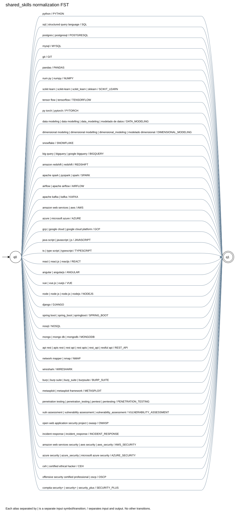
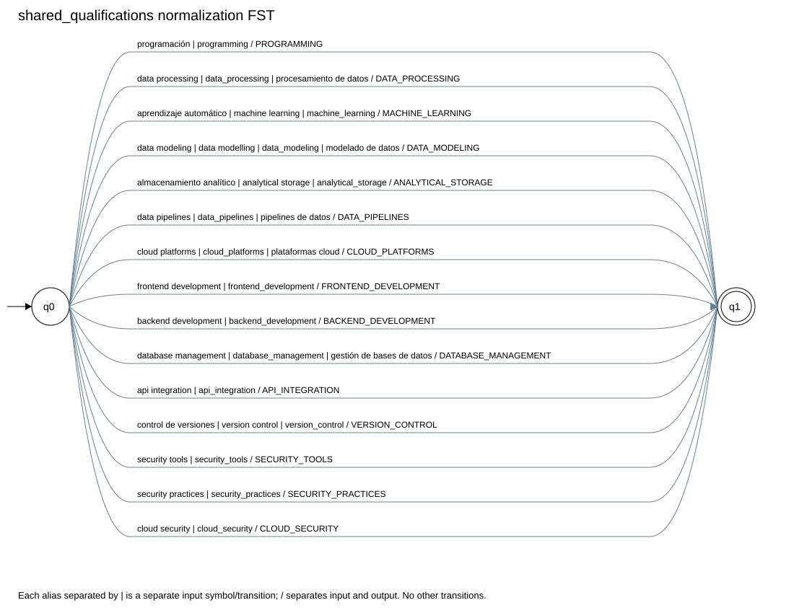
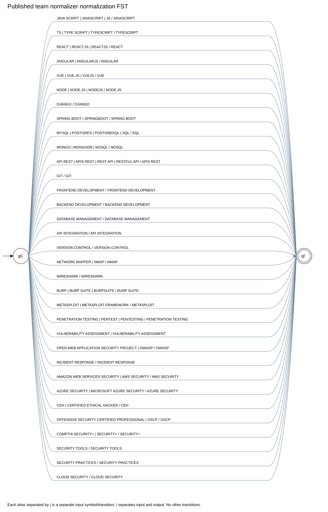

# Shared extraction and normalization models

All four profiles use these two separate pyformlang FSTs. Competence names and technologies occupy different namespaces.
No FST transforms personal names, years, or proficiency levels. Levels are explicitly extracted integers.

## Extraction expressions

A combined regex orders escaped aliases longest first; it squeezes variable whitespace with `\s+` and uses `(?<!\w)` / `(?!\w)` boundaries.
Stage 1 preserves the matched spelling. Contact URLs/email and explicit area-level declarations are masked before matching technology claims.
Names accept Unicode first-line names or `mi nombre es` / `my name is`. Anchors take priority.
Experiences accept semicolon/period followed by `tengo N años de experiencia` or `mi experiencia es de N años`; repeated records retain their own years.

Exact regex constants are in [the extractor](../../src/stage1/extract_data.py).

## shared_skills

M = (Q, Sigma, Gamma, delta, omega, q0, F).

- Q = {q0, q1}; initial q0; F = {q1}.
- Sigma = the complete input column below, each alias an atomic symbol.
- Gamma = {PYTHON, SQL, POSTGRESQL, MYSQL, GIT, PANDAS, NUMPY, SCIKIT_LEARN, TENSORFLOW, PYTORCH, DATA_MODELING, DIMENSIONAL_MODELING, SNOWFLAKE, BIGQUERY, REDSHIFT, SPARK, AIRFLOW, KAFKA, AWS, AZURE, GCP, JAVASCRIPT, TYPESCRIPT, REACT, ANGULAR, VUE, NODEJS, DJANGO, SPRING_BOOT, NOSQL, MONGODB, REST_API, NMAP, WIRESHARK, BURP_SUITE, METASPLOIT, PENETRATION_TESTING, VULNERABILITY_ASSESSMENT, OWASP, INCIDENT_RESPONSE, AWS_SECURITY, AZURE_SECURITY, CEH, OSCP, SECURITY_PLUS}.
- Each row defines delta(q0, alias) = q1 and omega(q0, alias) = [canonical]. No other transitions.
- casefold and whitespace squeezing prepare the input; equivalence is performed by the FST.
- Reset per term; unknown terms have no accepting path. Deduplication is performed after translation.

| Input | Output | delta | omega |
|---|---|---|---|
| `python` | `PYTHON` | q0 -> q1 | [PYTHON] |
| `sql` | `SQL` | q0 -> q1 | [SQL] |
| `structured query language` | `SQL` | q0 -> q1 | [SQL] |
| `postgres` | `POSTGRESQL` | q0 -> q1 | [POSTGRESQL] |
| `postgresql` | `POSTGRESQL` | q0 -> q1 | [POSTGRESQL] |
| `mysql` | `MYSQL` | q0 -> q1 | [MYSQL] |
| `git` | `GIT` | q0 -> q1 | [GIT] |
| `pandas` | `PANDAS` | q0 -> q1 | [PANDAS] |
| `num py` | `NUMPY` | q0 -> q1 | [NUMPY] |
| `numpy` | `NUMPY` | q0 -> q1 | [NUMPY] |
| `scikit learn` | `SCIKIT_LEARN` | q0 -> q1 | [SCIKIT_LEARN] |
| `scikit-learn` | `SCIKIT_LEARN` | q0 -> q1 | [SCIKIT_LEARN] |
| `scikit_learn` | `SCIKIT_LEARN` | q0 -> q1 | [SCIKIT_LEARN] |
| `sklearn` | `SCIKIT_LEARN` | q0 -> q1 | [SCIKIT_LEARN] |
| `tensor flow` | `TENSORFLOW` | q0 -> q1 | [TENSORFLOW] |
| `tensorflow` | `TENSORFLOW` | q0 -> q1 | [TENSORFLOW] |
| `py torch` | `PYTORCH` | q0 -> q1 | [PYTORCH] |
| `pytorch` | `PYTORCH` | q0 -> q1 | [PYTORCH] |
| `data modeling` | `DATA_MODELING` | q0 -> q1 | [DATA_MODELING] |
| `data modelling` | `DATA_MODELING` | q0 -> q1 | [DATA_MODELING] |
| `data_modeling` | `DATA_MODELING` | q0 -> q1 | [DATA_MODELING] |
| `modelado de datos` | `DATA_MODELING` | q0 -> q1 | [DATA_MODELING] |
| `dimensional modeling` | `DIMENSIONAL_MODELING` | q0 -> q1 | [DIMENSIONAL_MODELING] |
| `dimensional modelling` | `DIMENSIONAL_MODELING` | q0 -> q1 | [DIMENSIONAL_MODELING] |
| `dimensional_modeling` | `DIMENSIONAL_MODELING` | q0 -> q1 | [DIMENSIONAL_MODELING] |
| `modelado dimensional` | `DIMENSIONAL_MODELING` | q0 -> q1 | [DIMENSIONAL_MODELING] |
| `snowflake` | `SNOWFLAKE` | q0 -> q1 | [SNOWFLAKE] |
| `big query` | `BIGQUERY` | q0 -> q1 | [BIGQUERY] |
| `bigquery` | `BIGQUERY` | q0 -> q1 | [BIGQUERY] |
| `google bigquery` | `BIGQUERY` | q0 -> q1 | [BIGQUERY] |
| `amazon redshift` | `REDSHIFT` | q0 -> q1 | [REDSHIFT] |
| `redshift` | `REDSHIFT` | q0 -> q1 | [REDSHIFT] |
| `apache spark` | `SPARK` | q0 -> q1 | [SPARK] |
| `pyspark` | `SPARK` | q0 -> q1 | [SPARK] |
| `spark` | `SPARK` | q0 -> q1 | [SPARK] |
| `airflow` | `AIRFLOW` | q0 -> q1 | [AIRFLOW] |
| `apache airflow` | `AIRFLOW` | q0 -> q1 | [AIRFLOW] |
| `apache kafka` | `KAFKA` | q0 -> q1 | [KAFKA] |
| `kafka` | `KAFKA` | q0 -> q1 | [KAFKA] |
| `amazon web services` | `AWS` | q0 -> q1 | [AWS] |
| `aws` | `AWS` | q0 -> q1 | [AWS] |
| `azure` | `AZURE` | q0 -> q1 | [AZURE] |
| `microsoft azure` | `AZURE` | q0 -> q1 | [AZURE] |
| `gcp` | `GCP` | q0 -> q1 | [GCP] |
| `google cloud` | `GCP` | q0 -> q1 | [GCP] |
| `google cloud platform` | `GCP` | q0 -> q1 | [GCP] |
| `java script` | `JAVASCRIPT` | q0 -> q1 | [JAVASCRIPT] |
| `javascript` | `JAVASCRIPT` | q0 -> q1 | [JAVASCRIPT] |
| `js` | `JAVASCRIPT` | q0 -> q1 | [JAVASCRIPT] |
| `ts` | `TYPESCRIPT` | q0 -> q1 | [TYPESCRIPT] |
| `type script` | `TYPESCRIPT` | q0 -> q1 | [TYPESCRIPT] |
| `typescript` | `TYPESCRIPT` | q0 -> q1 | [TYPESCRIPT] |
| `react` | `REACT` | q0 -> q1 | [REACT] |
| `react.js` | `REACT` | q0 -> q1 | [REACT] |
| `reactjs` | `REACT` | q0 -> q1 | [REACT] |
| `angular` | `ANGULAR` | q0 -> q1 | [ANGULAR] |
| `angularjs` | `ANGULAR` | q0 -> q1 | [ANGULAR] |
| `vue` | `VUE` | q0 -> q1 | [VUE] |
| `vue.js` | `VUE` | q0 -> q1 | [VUE] |
| `vuejs` | `VUE` | q0 -> q1 | [VUE] |
| `node` | `NODEJS` | q0 -> q1 | [NODEJS] |
| `node js` | `NODEJS` | q0 -> q1 | [NODEJS] |
| `node.js` | `NODEJS` | q0 -> q1 | [NODEJS] |
| `nodejs` | `NODEJS` | q0 -> q1 | [NODEJS] |
| `django` | `DJANGO` | q0 -> q1 | [DJANGO] |
| `spring boot` | `SPRING_BOOT` | q0 -> q1 | [SPRING_BOOT] |
| `spring_boot` | `SPRING_BOOT` | q0 -> q1 | [SPRING_BOOT] |
| `springboot` | `SPRING_BOOT` | q0 -> q1 | [SPRING_BOOT] |
| `nosql` | `NOSQL` | q0 -> q1 | [NOSQL] |
| `mongo` | `MONGODB` | q0 -> q1 | [MONGODB] |
| `mongo db` | `MONGODB` | q0 -> q1 | [MONGODB] |
| `mongodb` | `MONGODB` | q0 -> q1 | [MONGODB] |
| `api rest` | `REST_API` | q0 -> q1 | [REST_API] |
| `apis rest` | `REST_API` | q0 -> q1 | [REST_API] |
| `rest api` | `REST_API` | q0 -> q1 | [REST_API] |
| `rest apis` | `REST_API` | q0 -> q1 | [REST_API] |
| `rest_api` | `REST_API` | q0 -> q1 | [REST_API] |
| `restful api` | `REST_API` | q0 -> q1 | [REST_API] |
| `network mapper` | `NMAP` | q0 -> q1 | [NMAP] |
| `nmap` | `NMAP` | q0 -> q1 | [NMAP] |
| `wireshark` | `WIRESHARK` | q0 -> q1 | [WIRESHARK] |
| `burp` | `BURP_SUITE` | q0 -> q1 | [BURP_SUITE] |
| `burp suite` | `BURP_SUITE` | q0 -> q1 | [BURP_SUITE] |
| `burp_suite` | `BURP_SUITE` | q0 -> q1 | [BURP_SUITE] |
| `burpsuite` | `BURP_SUITE` | q0 -> q1 | [BURP_SUITE] |
| `metasploit` | `METASPLOIT` | q0 -> q1 | [METASPLOIT] |
| `metasploit framework` | `METASPLOIT` | q0 -> q1 | [METASPLOIT] |
| `penetration testing` | `PENETRATION_TESTING` | q0 -> q1 | [PENETRATION_TESTING] |
| `penetration_testing` | `PENETRATION_TESTING` | q0 -> q1 | [PENETRATION_TESTING] |
| `pentest` | `PENETRATION_TESTING` | q0 -> q1 | [PENETRATION_TESTING] |
| `pentesting` | `PENETRATION_TESTING` | q0 -> q1 | [PENETRATION_TESTING] |
| `vuln assessment` | `VULNERABILITY_ASSESSMENT` | q0 -> q1 | [VULNERABILITY_ASSESSMENT] |
| `vulnerability assessment` | `VULNERABILITY_ASSESSMENT` | q0 -> q1 | [VULNERABILITY_ASSESSMENT] |
| `vulnerability_assessment` | `VULNERABILITY_ASSESSMENT` | q0 -> q1 | [VULNERABILITY_ASSESSMENT] |
| `open web application security project` | `OWASP` | q0 -> q1 | [OWASP] |
| `owasp` | `OWASP` | q0 -> q1 | [OWASP] |
| `incident response` | `INCIDENT_RESPONSE` | q0 -> q1 | [INCIDENT_RESPONSE] |
| `incident_response` | `INCIDENT_RESPONSE` | q0 -> q1 | [INCIDENT_RESPONSE] |
| `amazon web services security` | `AWS_SECURITY` | q0 -> q1 | [AWS_SECURITY] |
| `aws security` | `AWS_SECURITY` | q0 -> q1 | [AWS_SECURITY] |
| `aws_security` | `AWS_SECURITY` | q0 -> q1 | [AWS_SECURITY] |
| `azure security` | `AZURE_SECURITY` | q0 -> q1 | [AZURE_SECURITY] |
| `azure_security` | `AZURE_SECURITY` | q0 -> q1 | [AZURE_SECURITY] |
| `microsoft azure security` | `AZURE_SECURITY` | q0 -> q1 | [AZURE_SECURITY] |
| `ceh` | `CEH` | q0 -> q1 | [CEH] |
| `certified ethical hacker` | `CEH` | q0 -> q1 | [CEH] |
| `offensive security certified professional` | `OSCP` | q0 -> q1 | [OSCP] |
| `oscp` | `OSCP` | q0 -> q1 | [OSCP] |
| `comptia security+` | `SECURITY_PLUS` | q0 -> q1 | [SECURITY_PLUS] |
| `security+` | `SECURITY_PLUS` | q0 -> q1 | [SECURITY_PLUS] |
| `security_plus` | `SECURITY_PLUS` | q0 -> q1 | [SECURITY_PLUS] |

[Complete transitions](diagrams/shared_skills_fst.dot)

## shared_qualifications

M = (Q, Sigma, Gamma, delta, omega, q0, F).

- Q = {q0, q1}; initial q0; F = {q1}.
- Sigma = the complete input column below, each alias an atomic symbol.
- Gamma = {PROGRAMMING, DATA_PROCESSING, MACHINE_LEARNING, DATA_MODELING, ANALYTICAL_STORAGE, DATA_PIPELINES, CLOUD_PLATFORMS, FRONTEND_DEVELOPMENT, BACKEND_DEVELOPMENT, DATABASE_MANAGEMENT, API_INTEGRATION, VERSION_CONTROL, SECURITY_TOOLS, SECURITY_PRACTICES, CLOUD_SECURITY}.
- Each row defines delta(q0, alias) = q1 and omega(q0, alias) = [canonical]. No other transitions.
- casefold and whitespace squeezing prepare the input; equivalence is performed by the FST.
- Reset per term; unknown terms have no accepting path. Deduplication is performed after translation.

| Input | Output | delta | omega |
|---|---|---|---|
| `programación` | `PROGRAMMING` | q0 -> q1 | [PROGRAMMING] |
| `programming` | `PROGRAMMING` | q0 -> q1 | [PROGRAMMING] |
| `data processing` | `DATA_PROCESSING` | q0 -> q1 | [DATA_PROCESSING] |
| `data_processing` | `DATA_PROCESSING` | q0 -> q1 | [DATA_PROCESSING] |
| `procesamiento de datos` | `DATA_PROCESSING` | q0 -> q1 | [DATA_PROCESSING] |
| `aprendizaje automático` | `MACHINE_LEARNING` | q0 -> q1 | [MACHINE_LEARNING] |
| `machine learning` | `MACHINE_LEARNING` | q0 -> q1 | [MACHINE_LEARNING] |
| `machine_learning` | `MACHINE_LEARNING` | q0 -> q1 | [MACHINE_LEARNING] |
| `data modeling` | `DATA_MODELING` | q0 -> q1 | [DATA_MODELING] |
| `data modelling` | `DATA_MODELING` | q0 -> q1 | [DATA_MODELING] |
| `data_modeling` | `DATA_MODELING` | q0 -> q1 | [DATA_MODELING] |
| `modelado de datos` | `DATA_MODELING` | q0 -> q1 | [DATA_MODELING] |
| `almacenamiento analítico` | `ANALYTICAL_STORAGE` | q0 -> q1 | [ANALYTICAL_STORAGE] |
| `analytical storage` | `ANALYTICAL_STORAGE` | q0 -> q1 | [ANALYTICAL_STORAGE] |
| `analytical_storage` | `ANALYTICAL_STORAGE` | q0 -> q1 | [ANALYTICAL_STORAGE] |
| `data pipelines` | `DATA_PIPELINES` | q0 -> q1 | [DATA_PIPELINES] |
| `data_pipelines` | `DATA_PIPELINES` | q0 -> q1 | [DATA_PIPELINES] |
| `pipelines de datos` | `DATA_PIPELINES` | q0 -> q1 | [DATA_PIPELINES] |
| `cloud platforms` | `CLOUD_PLATFORMS` | q0 -> q1 | [CLOUD_PLATFORMS] |
| `cloud_platforms` | `CLOUD_PLATFORMS` | q0 -> q1 | [CLOUD_PLATFORMS] |
| `plataformas cloud` | `CLOUD_PLATFORMS` | q0 -> q1 | [CLOUD_PLATFORMS] |
| `frontend development` | `FRONTEND_DEVELOPMENT` | q0 -> q1 | [FRONTEND_DEVELOPMENT] |
| `frontend_development` | `FRONTEND_DEVELOPMENT` | q0 -> q1 | [FRONTEND_DEVELOPMENT] |
| `backend development` | `BACKEND_DEVELOPMENT` | q0 -> q1 | [BACKEND_DEVELOPMENT] |
| `backend_development` | `BACKEND_DEVELOPMENT` | q0 -> q1 | [BACKEND_DEVELOPMENT] |
| `database management` | `DATABASE_MANAGEMENT` | q0 -> q1 | [DATABASE_MANAGEMENT] |
| `database_management` | `DATABASE_MANAGEMENT` | q0 -> q1 | [DATABASE_MANAGEMENT] |
| `gestión de bases de datos` | `DATABASE_MANAGEMENT` | q0 -> q1 | [DATABASE_MANAGEMENT] |
| `api integration` | `API_INTEGRATION` | q0 -> q1 | [API_INTEGRATION] |
| `api_integration` | `API_INTEGRATION` | q0 -> q1 | [API_INTEGRATION] |
| `control de versiones` | `VERSION_CONTROL` | q0 -> q1 | [VERSION_CONTROL] |
| `version control` | `VERSION_CONTROL` | q0 -> q1 | [VERSION_CONTROL] |
| `version_control` | `VERSION_CONTROL` | q0 -> q1 | [VERSION_CONTROL] |
| `security tools` | `SECURITY_TOOLS` | q0 -> q1 | [SECURITY_TOOLS] |
| `security_tools` | `SECURITY_TOOLS` | q0 -> q1 | [SECURITY_TOOLS] |
| `security practices` | `SECURITY_PRACTICES` | q0 -> q1 | [SECURITY_PRACTICES] |
| `security_practices` | `SECURITY_PRACTICES` | q0 -> q1 | [SECURITY_PRACTICES] |
| `cloud security` | `CLOUD_SECURITY` | q0 -> q1 | [CLOUD_SECURITY] |
| `cloud_security` | `CLOUD_SECURITY` | q0 -> q1 | [CLOUD_SECURITY] |

[Complete transitions](diagrams/shared_qualifications_fst.dot)

## published_team_normalizer

Full Stack and Cybersecurity also execute Emmanuel's unchanged global normalizer from `4a102a7`.
It combines the native skill and area aliases in a single FST. The adapter maps its outputs to the shared contract and checks them against extracted evidence.

M = (Q, Sigma, Gamma, delta, omega, q0, F).

- Q = {q0, qf}; initial q0; F = {qf}.
- Sigma is exactly the input column below; complete uppercase aliases are atomic symbols.
- Gamma = {JAVASCRIPT, TYPESCRIPT, REACT, ANGULAR, VUE, NODE.JS, DJANGO, SPRING BOOT, SQL, NOSQL, APIS REST, GIT, FRONTEND DEVELOPMENT, BACKEND DEVELOPMENT, DATABASE MANAGEMENT, API INTEGRATION, VERSION CONTROL, NMAP, WIRESHARK, BURP SUITE, METASPLOIT, PENETRATION TESTING, VULNERABILITY ASSESSMENT, OWASP, INCIDENT RESPONSE, AWS SECURITY, AZURE SECURITY, CEH, OSCP, SECURITY+, SECURITY TOOLS, SECURITY PRACTICES, CLOUD SECURITY}.
- Each row defines delta(q0, alias) = qf and omega(q0, alias) = [canonical]. No other transitions.
- The published normalizar function applies upper() before translation; reset per extracted term.
- Qualifications retain their separately extracted level in (level, canonical area) tuples.

| Input | Output | delta | omega |
|---|---|---|---|
| `JAVA SCRIPT` | `JAVASCRIPT` | q0 -> qf | [JAVASCRIPT] |
| `JAVASCRIPT` | `JAVASCRIPT` | q0 -> qf | [JAVASCRIPT] |
| `JS` | `JAVASCRIPT` | q0 -> qf | [JAVASCRIPT] |
| `TS` | `TYPESCRIPT` | q0 -> qf | [TYPESCRIPT] |
| `TYPE SCRIPT` | `TYPESCRIPT` | q0 -> qf | [TYPESCRIPT] |
| `TYPESCRIPT` | `TYPESCRIPT` | q0 -> qf | [TYPESCRIPT] |
| `REACT` | `REACT` | q0 -> qf | [REACT] |
| `REACT.JS` | `REACT` | q0 -> qf | [REACT] |
| `REACTJS` | `REACT` | q0 -> qf | [REACT] |
| `ANGULAR` | `ANGULAR` | q0 -> qf | [ANGULAR] |
| `ANGULARJS` | `ANGULAR` | q0 -> qf | [ANGULAR] |
| `VUE` | `VUE` | q0 -> qf | [VUE] |
| `VUE.JS` | `VUE` | q0 -> qf | [VUE] |
| `VUEJS` | `VUE` | q0 -> qf | [VUE] |
| `NODE` | `NODE.JS` | q0 -> qf | [NODE.JS] |
| `NODE.JS` | `NODE.JS` | q0 -> qf | [NODE.JS] |
| `NODEJS` | `NODE.JS` | q0 -> qf | [NODE.JS] |
| `DJANGO` | `DJANGO` | q0 -> qf | [DJANGO] |
| `SPRING BOOT` | `SPRING BOOT` | q0 -> qf | [SPRING BOOT] |
| `SPRINGBOOT` | `SPRING BOOT` | q0 -> qf | [SPRING BOOT] |
| `MYSQL` | `SQL` | q0 -> qf | [SQL] |
| `POSTGRES` | `SQL` | q0 -> qf | [SQL] |
| `POSTGRESQL` | `SQL` | q0 -> qf | [SQL] |
| `SQL` | `SQL` | q0 -> qf | [SQL] |
| `MONGO` | `NOSQL` | q0 -> qf | [NOSQL] |
| `MONGODB` | `NOSQL` | q0 -> qf | [NOSQL] |
| `NOSQL` | `NOSQL` | q0 -> qf | [NOSQL] |
| `API REST` | `APIS REST` | q0 -> qf | [APIS REST] |
| `APIS REST` | `APIS REST` | q0 -> qf | [APIS REST] |
| `REST API` | `APIS REST` | q0 -> qf | [APIS REST] |
| `RESTFUL API` | `APIS REST` | q0 -> qf | [APIS REST] |
| `GIT` | `GIT` | q0 -> qf | [GIT] |
| `FRONTEND DEVELOPMENT` | `FRONTEND DEVELOPMENT` | q0 -> qf | [FRONTEND DEVELOPMENT] |
| `BACKEND DEVELOPMENT` | `BACKEND DEVELOPMENT` | q0 -> qf | [BACKEND DEVELOPMENT] |
| `DATABASE MANAGEMENT` | `DATABASE MANAGEMENT` | q0 -> qf | [DATABASE MANAGEMENT] |
| `API INTEGRATION` | `API INTEGRATION` | q0 -> qf | [API INTEGRATION] |
| `VERSION CONTROL` | `VERSION CONTROL` | q0 -> qf | [VERSION CONTROL] |
| `NETWORK MAPPER` | `NMAP` | q0 -> qf | [NMAP] |
| `NMAP` | `NMAP` | q0 -> qf | [NMAP] |
| `WIRESHARK` | `WIRESHARK` | q0 -> qf | [WIRESHARK] |
| `BURP` | `BURP SUITE` | q0 -> qf | [BURP SUITE] |
| `BURP SUITE` | `BURP SUITE` | q0 -> qf | [BURP SUITE] |
| `BURPSUITE` | `BURP SUITE` | q0 -> qf | [BURP SUITE] |
| `METASPLOIT` | `METASPLOIT` | q0 -> qf | [METASPLOIT] |
| `METASPLOIT FRAMEWORK` | `METASPLOIT` | q0 -> qf | [METASPLOIT] |
| `PENETRATION TESTING` | `PENETRATION TESTING` | q0 -> qf | [PENETRATION TESTING] |
| `PENTEST` | `PENETRATION TESTING` | q0 -> qf | [PENETRATION TESTING] |
| `PENTESTING` | `PENETRATION TESTING` | q0 -> qf | [PENETRATION TESTING] |
| `VULNERABILITY ASSESSMENT` | `VULNERABILITY ASSESSMENT` | q0 -> qf | [VULNERABILITY ASSESSMENT] |
| `OPEN WEB APPLICATION SECURITY PROJECT` | `OWASP` | q0 -> qf | [OWASP] |
| `OWASP` | `OWASP` | q0 -> qf | [OWASP] |
| `INCIDENT RESPONSE` | `INCIDENT RESPONSE` | q0 -> qf | [INCIDENT RESPONSE] |
| `AMAZON WEB SERVICES SECURITY` | `AWS SECURITY` | q0 -> qf | [AWS SECURITY] |
| `AWS SECURITY` | `AWS SECURITY` | q0 -> qf | [AWS SECURITY] |
| `AZURE SECURITY` | `AZURE SECURITY` | q0 -> qf | [AZURE SECURITY] |
| `MICROSOFT AZURE SECURITY` | `AZURE SECURITY` | q0 -> qf | [AZURE SECURITY] |
| `CEH` | `CEH` | q0 -> qf | [CEH] |
| `CERTIFIED ETHICAL HACKER` | `CEH` | q0 -> qf | [CEH] |
| `OFFENSIVE SECURITY CERTIFIED PROFESSIONAL` | `OSCP` | q0 -> qf | [OSCP] |
| `OSCP` | `OSCP` | q0 -> qf | [OSCP] |
| `COMPTIA SECURITY+` | `SECURITY+` | q0 -> qf | [SECURITY+] |
| `SECURITY+` | `SECURITY+` | q0 -> qf | [SECURITY+] |
| `SECURITY TOOLS` | `SECURITY TOOLS` | q0 -> qf | [SECURITY TOOLS] |
| `SECURITY PRACTICES` | `SECURITY PRACTICES` | q0 -> qf | [SECURITY PRACTICES] |
| `CLOUD SECURITY` | `CLOUD SECURITY` | q0 -> qf | [CLOUD SECURITY] |

[Complete transitions](diagrams/published_team_normalizer_fst.dot)
